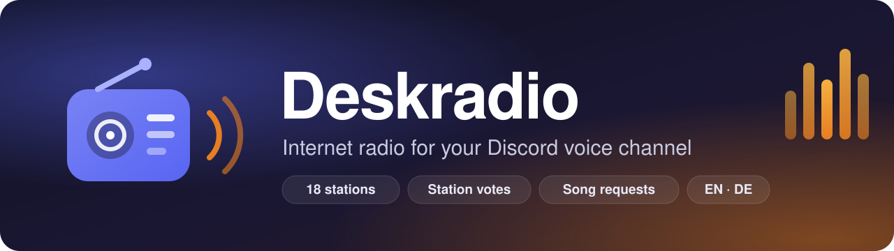

<p align="center">
  
</p>

<p align="center">
  <a href="https://github.com/enricofranke/deskradio/actions/workflows/ci.yml"></a>
  <a href="https://github.com/enricofranke/deskradio/actions/workflows/docker.yml"></a>
  <a href="https://github.com/enricofranke/deskradio/releases"></a>
  <a href="LICENSE"></a>
  
</p>

<p align="center">
  <a href="README.md">English</a> · <b>Deutsch</b>
</p>

**Deskradio** ist ein Discord-Bot zum Selbsthosten. Er sitzt in einem Sprachkanal und spielt Internetradio: Lofi zum Arbeiten, Synthwave, Drum & Bass, Deutschrap oder die Charts. Alle im Kanal können für einen anderen Sender abstimmen, Songs von YouTube oder SoundCloud wünschen und in einem Live-Panel direkt im Chat des Sprachkanals sehen, was gerade läuft.

Entstanden ist er für einen Coworking-Kanal, in dem Leute stundenlang zusammensitzen und im Hintergrund dieselbe Musik hören wollen, ohne dass jemand DJ spielen muss.

## Funktionen

- **18 Sender eingebaut:** Lofi, Synthwave, EDM, sechs NCS-Sender, SomaFM, Deutschrap, Hip-Hop und Hits ([ganze Liste](#sender)).
- **Live-Panel im Chat des Sprachkanals.** Es zeigt Sender, laufenden Song mit Album-Cover, Zuhörende, Warteschlange und die letzte Änderung. Sender wählt man im Dropdown, ganz ohne Befehl.
- **Faire Abstimmungen.** Mehr Ja als Nein gewinnt, wer nichts drückt, blockiert nicht. Das Team wechselt sofort.
- **Wünsche** von YouTube und SoundCloud, mit Warteschlange, Grenzen und Überspringen per Abstimmung. Lassen sich abschalten.
- **Playlists und YouTube-Mixe** von YouTube und SoundCloud: eine ganze Playlist oder einen endlosen Mix abspielen, einzelne Songs oder die ganze Playlist überspringen, danach kommt wieder das Radio.
- **Spielt nur, wenn jemand zuhört.** Verbindet sich selbst neu und wartet länger, wenn ein Stream ausfällt.
- **Guter Klang.** Übernimmt die Bitrate des Kanals, auf geboosteten Servern bis 384 kbit/s.
- **Kanalstatus.** Der laufende Song steht unter dem Kanalnamen.
- **Deutsch und Englisch.** Die Slash-Befehle erscheinen in der Discord-Sprache der jeweiligen Person.
- **Merkt sich** Sender, Lautstärke und an/aus über Neustarts hinweg.
- **Klein.** Ein Prozess, keine Datenbank. Docker-Images für amd64 und arm64, läuft also auch auf einem Raspberry Pi.

## Schnellstart

### 1. Bot bei Discord anlegen

1. Im [Discord Developer Portal](https://discord.com/developers/applications) → **New Application**, Namen vergeben, z. B. „Radio“. Name und App-Icon sehen die Leute in der Mitgliederliste.
2. Unter **Bot** → **Reset Token** → Token kopieren. Geheim halten: Wer ihn hat, steuert deinen Bot.
3. Privilegierte Intents braucht er keine, alle ausgeschaltet lassen.
4. Bot einladen. `YOUR_APP_ID` durch die **Application ID** aus **General Information** ersetzen:

   ```
   https://discord.com/oauth2/authorize?client_id=YOUR_APP_ID&scope=bot%20applications.commands&permissions=281474979941376
   ```

   Das sind die Rechte: Kanal ansehen, Nachrichten senden, Links einbetten, Nachrichtenverlauf lesen, Verbinden, Sprechen und Status des Sprachkanals festlegen. Startest du den Bot vor der Einladung, steht der Link auch im Log.

5. IDs kopieren: In Discord **Einstellungen → Erweitert → Entwicklermodus** an, dann Rechtsklick auf Server und Sprachkanal → **ID kopieren**.

### 2. Starten

**Mit Docker Compose (empfohlen)**

```bash
mkdir deskradio && cd deskradio
curl -fsSLO https://raw.githubusercontent.com/enricofranke/deskradio/main/docker-compose.yml
curl -fsSL -o .env https://raw.githubusercontent.com/enricofranke/deskradio/main/.env.example
nano .env   # RADIO_BOT_TOKEN, RADIO_GUILD_ID und RADIO_CHANNEL_ID eintragen, RADIO_LANGUAGE=de
docker compose up -d
docker compose logs -f
```

**Mit Docker**

```bash
docker run -d --name deskradio --restart unless-stopped \
  --env-file .env -e NODE_ENV=production \
  -e RADIO_STATE_FILE=/app/data/state.json -e RADIO_CACHE_DIR=/tmp/deskradio-cache \
  -v deskradio-data:/app/data \
  ghcr.io/enricofranke/deskradio:latest
```

**Mit Node.js.** Braucht Node 22+, ffmpeg mit libopus und für Wünsche [yt-dlp](https://github.com/yt-dlp/yt-dlp).

```bash
git clone https://github.com/enricofranke/deskradio.git && cd deskradio
npm ci
cp .env.example .env    # IDs eintragen
npm run token           # vorher den Token kopieren; schreibt ihn in .env, ohne ihn anzuzeigen
npm run build && npm start
```

### 3. Fertig

Im Log steht `Deskradio is ready`, der Bot betritt den Sprachkanal und das Panel erscheint im Chat des Kanals. Die Musik startet, sobald jemand reinkommt.

## Befehle

Alles geht auch über das Panel. Discord-Clients auf Englisch zeigen die englischen Namen.

| Befehl | Englisch | Wer | Was |
| --- | --- | --- | --- |
| `/radio sender` | `/radio station` | alle | Das Team wechselt sofort, alle anderen starten eine Abstimmung |
| `/radio jetzt` | `/radio now` | alle | Sender, laufender Song und Zuhörende |
| `/radio lautstärke [prozent]` | `/radio volume` | alle / Team | Zeigt die Lautstärke; das Team stellt sie ein (1–100 %) |
| `/radio wunsch link` | `/radio request` | Zuhörende, Team | Wünscht einen Song von YouTube oder SoundCloud (ein Playlist-Link startet die Playlist); das Team kann ihn sofort spielen |
| `/radio playlist link [zufällig]` | `/radio playlist [shuffle]` | Zuhörende, Team | Spielt eine YouTube- oder SoundCloud-Playlist, auf Wunsch gemischt |
| `/radio skip` | `/radio skip` | alle | Überspringt den laufenden Wunsch oder Playlist-Song: Team und Wünschende sofort, sonst per Abstimmung |
| `/radio playlist-überspringen` | `/radio playlist-skip` | alle | Überspringt die ganze Playlist: Team und wer sie gestartet hat sofort, sonst per Abstimmung |
| `/radio leeren` | `/radio clear` | Team | Leert die Warteschlange |
| `/radio aus` / `an` | `/radio off` / `on` | Team | Schaltet das Radio aus oder an |

**Team** sind der Server-Owner, alle mit Administrator und die Rollen aus `RADIO_TEAM_ROLES`. Für sich allein kann jede Person den Bot leiser machen: Rechtsklick auf den Bot → Benutzerlautstärke.

## So funktionieren Abstimmungen

- Abstimmen kann nur, wer im Kanal sitzt und nicht taub geschaltet ist. Wer abstimmen lässt, hat schon Ja gesagt.
- Nach 60 Sekunden gilt: **mehr Ja als Nein** gewinnt. Wer nichts drückt, zählt nicht dagegen, bei Gleichstand bleibt der alte Sender.
- Steht das Ergebnis vorher fest, endet sie früher. Wer den Kanal verlässt, nimmt seine Stimme mit.
- Allein im Kanal wird sofort gewechselt.
- Nach einer Abstimmung und nach einem Wechsel durch das Team gilt eine Pause von 3 Minuten.

Überspringen (Song oder ganze Playlist) läuft genauso, mit 30 Sekunden. Alle Werte stehen in [`src/settings.ts`](src/settings.ts).

## Wünsche

- Wünschen darf, wer im Kanal zuhört, das Team auch von außerhalb.
- yt-dlp liest Titel und Länge und lädt die Tonspur vorab herunter, damit nichts hakt. Jede Datei wird gelöscht, sobald ihr Titel gelaufen ist.
- Solange Wünsche in der Schlange sind, pausiert das Radio, danach läuft wieder der letzte Sender.
- Grenzen: höchstens 10 Minuten pro Titel, keine Livestreams, 2 Wünsche pro Person, 20 insgesamt. Das Team hat keine Längen- und keine Pro-Kopf-Grenze.
- Läuft schon ein Song oder warten Wünsche, fragt der Bot das Team: **▶️ Sofort abspielen** oder **➕ In die Warteschlange**. „Sofort“ stellt den Song ganz nach vorn; sobald er geladen ist, unterbricht er den laufenden Song, und der geht danach an derselben Stelle weiter.

## Playlists

- Den Playlist-Link (`youtube.com/playlist?list=…`, ein SoundCloud-Set) in **📃 Playlist** im Panel, in `/radio playlist` oder ins Wunsch-Formular einfügen. Ein Link zu einem Video in einer Playlist (`watch?v=…&list=…`) startet mit `/radio playlist` die Playlist bei diesem Video; im Wunsch-Formular bleibt er ein einzelner Song.
- **YouTube-Mixe** („Radio starten“, `watch?v=…&list=RD…&start_radio=1`) gehen auch, sogar im Wunsch-Formular. Ein Mix geht nie aus: Bevor er endet, holt der Bot einen neuen Mix ab dem letzten Song, ohne Wiederholungen. Er läuft, bis ihn jemand überspringt.
- Wünsche gehen vor: Sie laufen zwischen zwei Playlist-Songs, nie mitten in einem (außer das Team spielt einen Song sofort). Ist die Playlist durch, kommt wieder das Radio.
- YouTube-Songs laufen schon, während sie noch laden; der erste Song spielt meist 20–30 Sekunden nach dem Link, je nach Proxy. Das gilt nur, wenn der Download deutlich schneller läuft als die Wiedergabe; über einen langsamen Proxy-Ausgang wartet der Song, bis er komplett ist. Hängt ein Download trotzdem, ist es bis zu 30 Sekunden still, dann springt das Radio ein, und der Song geht an derselben Stelle weiter, sobald er geladen ist. Wer einen Song überspringt, der noch lädt, bricht den Download ab, damit der nächste sofort lädt.
- Antwortet YouTube mit der Bot-Prüfung („Sign in to confirm you're not a bot“), liegt das an der Proxy-Adresse, nicht am Song: Der Bot versucht denselben Song nach 15, 30, 60 und 120 Sekunden erneut, jedes Mal über eine neue Adresse. Erst wenn es dann noch hakt, endet die Playlist, und auch dann spielt der laufende Song zu Ende.
- Geladen werden nur der laufende und der nächste Song, nicht die ganze Liste. Private, gelöschte und Live-Videos fallen raus.
- **⏭️ Überspringen** überspringt den laufenden Playlist-Song, **⏹️ Playlist überspringen** die ganze Playlist. Team und wer die Playlist gestartet hat sofort, alle anderen per Abstimmung.
- Eine Playlist zur Zeit, höchstens 500 Songs. Eine laufende ersetzen kann nur das Team. Ohne Team-Rechte fallen Songs über 10 Minuten raus.

YouTube blockt yt-dlp zunehmend, vor allem von Server-IPs („Sign in to confirm you're not a bot“). Von einem Heimanschluss klappt es meist. Das Docker-Image bringt beim Bauen das aktuelle yt-dlp mit. Mit `RADIO_WISHES=off` sind Wünsche ganz aus; siehe auch den [rechtlichen Hinweis](#rechtliches).

## Einstellungen

Alles sind Umgebungsvariablen, meist in `.env`.

| Variable | Standard | Beschreibung |
| --- | --- | --- |
| `RADIO_BOT_TOKEN` | – | **Pflicht.** Bot-Token aus dem Developer Portal |
| `RADIO_GUILD_ID` | – | Server-ID. Ohne sie nimmt der Bot den einzigen Server, auf dem er ist, aber nur bei höchstens 10 Mitgliedern |
| `RADIO_CHANNEL_ID` | erster Sprachkanal | Sprachkanal, in dem er spielt |
| `RADIO_TEAM_ROLES` | – | Rollen-IDs (Komma-getrennt), die Sender und Lautstärke direkt ändern dürfen |
| `RADIO_NAME` | `Deskradio` | Name im Panel |
| `RADIO_LANGUAGE` | `en` | Sprache von Panel und Antworten: `en` oder `de` |
| `RADIO_WISHES` | `on` | Wünsche von YouTube und SoundCloud: `on` oder `off` |
| `RADIO_ERROR_CHANNEL_ID` | – | Textkanal für Fehlermeldungen, z. B. wenn keine Sprachverbindung zustande kommt |
| `RADIO_STATE_FILE` | `data/state.json` | Hier stehen Sender, Lautstärke und an/aus |
| `RADIO_CACHE_DIR` | `data/cache` | Hierhin lädt yt-dlp die Wünsche; wird bei jedem Start geleert |
| `RADIO_YTDLP` | `yt-dlp` | Pfad zu yt-dlp |
| `RADIO_YTDLP_COOKIES` | – | Cookie-Datei (Netscape-Format) für YouTube. Nötig, wenn YouTube „Sign in to confirm you're not a bot“ meldet, was auf Server-IPs häufig ist. Am besten mit einem eigenen Google-Konto |
| `RADIO_YTDLP_PROXY` | – | Proxy für yt-dlp, z. B. `socks5://host:1080` |
| `HEALTH_PORT` | `0` (Image: `8080`) | HTTP-Port für `/health`; `0` schaltet ihn ab |
| `LOG_LEVEL` | `info` | `debug`, `info`, `warn` oder `error` |
| `NODE_ENV` | – | `production` schreibt JSON-Logs |

Beim allerersten Start spielt der Bot Lofi mit 10 % Lautstärke. Danach gilt, was zuletzt eingestellt war.

## Sender

| Sender | Genre | Quelle |
| --- | --- | --- |
| Lofi | Chill | [cliamp](https://radio.cliamp.stream) |
| Synthwave | Retro-Elektro | cliamp |
| EDM | Elektro | cliamp |
| Omarchy Radio | Gemischt | cliamp |
| NCS, NCS House, NCS Dubstep, NCS Drum & Bass, NCS Trap, NCS Phonk | Elektro, House, Dubstep, Drum & Bass, Trap, Phonk | cliamp |
| SomaFM Groove Salad | Chill, Ambient-Beats | [SomaFM](https://somafm.com) |
| SomaFM Deep Space One | Ambient, Space | SomaFM |
| SomaFM DEF CON Radio | Elektro zum Coden | SomaFM |
| I♥ Deutschrap, I♥ Hip Hop, I♥ Radio | Deutschrap, Hip-Hop, Hits | [ILOVEMUSIC](https://www.ilovemusic.de) |
| bigFM Deutschrap | Deutschrap | [bigFM](https://www.bigfm.de) |
| 1LIVE | Hits & Pop | [WDR 1LIVE](https://www1.wdr.de/radio/1live/) |

Die Liste steht in `STATIONS` in [`src/settings.ts`](src/settings.ts). Jeder MP3-Stream von Icecast oder Shoutcast geht; mit `icy`-Metadaten zeigt das Panel auch den Songtitel. Mehr als 25 Sender fasst das Dropdown von Discord nicht.

## Hinweise zum Hosten

- **Nichts eingehend.** Der Bot baut nur ausgehende Verbindungen auf. Er braucht keine Portfreigabe, keine Domain und keinen Reverse Proxy.
- **Ausgehend braucht er:** TCP 443 (Discord-API, Streams, Cover, yt-dlp). Für den Ton zusätzlich **TCP und UDP zu den Voice-Servern von Discord**: den WebSocket über TCP (gesehen auf Port 2096) und den Ton über UDP 50000–65535. Strenge Firewalls und NetworkPolicies in Kubernetes sperren das oft; im Log steht dann `no voice connection` (siehe [Fehlersuche](#fehlersuche)).
- **Genau eine Instanz pro Bot-Token.** Zwei Instanzen streiten sich um den Sprachkanal und beantworten jeden Befehl doppelt. In Kubernetes: `replicas: 1` und `strategy: Recreate`.
- **`/app/data` behalten** (Docker-Volume oder kleine PVC), damit der letzte Sender einen Neustart übersteht. Der Container läuft als User `node` (UID 1000); in Kubernetes `fsGroup: 1000` setzen.
- **Ressourcen:** etwa 250 MB RAM und unter 5 % eines Kerns beim Streamen, kurz mehr, während yt-dlp einen Wunsch lädt.
- **Health:** `GET /health` antwortet mit 200, solange die Gateway-Verbindung zu Discord steht. Die Sprachverbindung baut der Bot selbst neu auf, ein Neustart durch die Probe hülfe da nicht.

## Fehlersuche

Die Logs sind auf Englisch.

| Im Log | Bedeutung | Was tun |
| --- | --- | --- |
| `Environment variable RADIO_BOT_TOKEN is missing` | Kein Token | In `.env` eintragen |
| `Startup failed` mit `TokenInvalid` | Falscher Token | Im Developer Portal neu erzeugen und eintragen |
| `The bot is not on any server yet` | Nicht eingeladen | Einladungslink aus dem Log nehmen |
| `No voice channel found` | Kanal-ID falsch oder fehlt | `RADIO_CHANNEL_ID` prüfen |
| `no voice connection` mit `stage: OpeningWs` | TCP zum Voice-Server gesperrt | Ausgehend TCP zur Adresse aus dem Log freigeben |
| `no voice connection` mit `stage: UdpHandshaking` | UDP gesperrt | Ausgehend UDP 50000–65535 freigeben |
| `not allowed to set the channel status` | Recht fehlt | „Status des Sprachkanals festlegen“ geben oder ignorieren |
| `Could not save state` mit `EACCES` | Datenordner nicht beschreibbar | Rechte prüfen oder `fsGroup: 1000` |
| `ffmpeg exited` / `stream dropped` | Sender nicht erreichbar | Meist kurz; er versucht es mit wachsender Pause erneut |
| `could not load track` mit „Sign in to confirm you're not a bot“ | YouTube sperrt die IP | Bekannt, das Radio läuft weiter |

Mit `RADIO_ERROR_CHANNEL_ID` landen Fehler der Sprachverbindung zusätzlich in Discord.

## Entwickeln

```bash
npm ci
npm run dev        # startet mit tsx, liest .env
npm test           # Rechte, Abstimmungen, Lautstärke, Bitrate, Zustand, Warteschlange, Playlists, Panel, Sprachen; ohne Discord und Audio
npm run typecheck
```

Der Aufbau steht im [englischen README](README.md#development). Beiträge sind willkommen; für größere Änderungen bitte zuerst ein Issue aufmachen.

## Rechtliches

Deskradio hat nichts mit Discord Inc. zu tun und wird von Discord nicht unterstützt. Die Radiostreams gehören den Sendern. Wer eine Deskradio-Instanz betreibt, ist selbst dafür verantwortlich, sie anderen vorspielen zu dürfen. Wünsche laden Audio mit yt-dlp herunter; die Nutzungsbedingungen von YouTube erlauben das nicht. Ob `RADIO_WISHES` an bleibt, entscheidest du.

## Credits und Lizenz

Gebaut von **Enrico Franke**. Veröffentlicht unter der [MIT-Lizenz](LICENSE): nutzen, ändern, weitergeben, nur der Copyright-Hinweis muss bleiben.

Im Panel steht klein „Deskradio · by Enrico Franke“. Wenn dir der Bot gefällt, lass die Zeile bitte drin; so finden andere das Projekt.

Gebaut mit [discord.js](https://discord.js.org), [@discordjs/voice](https://github.com/discordjs/discord.js/tree/main/packages/voice), [ffmpeg](https://ffmpeg.org) und [yt-dlp](https://github.com/yt-dlp/yt-dlp). Album-Cover kommen aus der iTunes-Suche.
