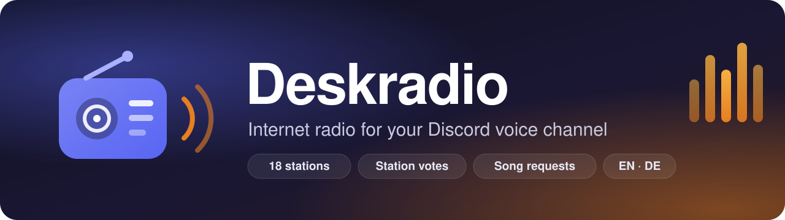

<p align="center">
  
</p>

<p align="center">
  <a href="https://github.com/enricofranke/deskradio/actions/workflows/ci.yml"></a>
  <a href="https://github.com/enricofranke/deskradio/actions/workflows/docker.yml"></a>
  <a href="https://github.com/enricofranke/deskradio/releases"></a>
  <a href="LICENSE"></a>
  
</p>

<p align="center">
  <b>English</b> · <a href="README.de.md">Deutsch</a>
</p>

**Deskradio** is a self-hosted Discord bot that lives in one voice channel and plays internet radio: lofi to work to, synthwave, drum & bass, hip-hop or the charts. Everyone in the channel can vote for another station, request songs from YouTube or SoundCloud, and see what's playing in a live panel right in the voice channel's chat.

It was built for a coworking channel, where people sit together for hours and want the same music in the background without anyone having to DJ.

## Features

- **18 stations built in:** lofi, synthwave, EDM, six NCS channels, SomaFM, hip-hop and hits ([full list](#stations)).
- **Live panel in the voice channel chat.** It shows the station, the current song with album cover, listeners, the queue and the last change. Pick a station from a dropdown, no command needed.
- **Fair votes.** More yes than no wins, and people who don't vote don't block. The team switches instantly.
- **Song requests** from YouTube and SoundCloud, with a queue, limits and vote-skip. You can turn them off.
- **Playlists and YouTube mixes** from YouTube and SoundCloud: play a whole playlist or an endless mix, skip single songs or the entire playlist, then the radio comes back.
- **Only plays when someone listens.** It reconnects by itself and backs off when a stream is down.
- **Crisp sound.** It follows the channel bitrate, up to 384 kbit/s on boosted servers.
- **Channel status.** The current song shows up under the channel name.
- **English and German.** Slash commands follow each user's Discord language.
- **Remembers** station, volume and on/off across restarts.
- **Small.** One process, no database. Docker images for amd64 and arm64, so it runs on a Raspberry Pi too.

## Quick start

### 1. Create the bot in Discord

1. Open the [Discord Developer Portal](https://discord.com/developers/applications) → **New Application** and give it a name, e.g. "Radio". That name and the app icon are what people see in the member list.
2. Go to **Bot** → **Reset Token** → copy the token. Keep it secret; anyone with it controls your bot.
3. No privileged intents are needed, leave them all off.
4. Invite the bot. Replace `YOUR_APP_ID` with the **Application ID** from **General Information**:

   ```
   https://discord.com/oauth2/authorize?client_id=YOUR_APP_ID&scope=bot%20applications.commands&permissions=281474979941376
   ```

   Those are the permissions: View Channel, Send Messages, Embed Links, Read Message History, Connect, Speak and Set Voice Channel Status. If you start the bot before inviting it, it prints this link in its log.

5. Copy the IDs: Discord **Settings → Advanced → Developer Mode**, then right-click your server and the voice channel → **Copy ID**.

### 2. Run it

**With Docker Compose (recommended)**

```bash
mkdir deskradio && cd deskradio
curl -fsSLO https://raw.githubusercontent.com/enricofranke/deskradio/main/docker-compose.yml
curl -fsSL -o .env https://raw.githubusercontent.com/enricofranke/deskradio/main/.env.example
nano .env   # set RADIO_BOT_TOKEN, RADIO_GUILD_ID and RADIO_CHANNEL_ID
docker compose up -d
docker compose logs -f
```

**With plain Docker**

```bash
docker run -d --name deskradio --restart unless-stopped \
  --env-file .env -e NODE_ENV=production \
  -e RADIO_STATE_FILE=/app/data/state.json -e RADIO_CACHE_DIR=/tmp/deskradio-cache \
  -v deskradio-data:/app/data \
  ghcr.io/enricofranke/deskradio:latest
```

**With Node.js.** Needs Node 22+, ffmpeg with libopus and, for song requests, [yt-dlp](https://github.com/yt-dlp/yt-dlp).

```bash
git clone https://github.com/enricofranke/deskradio.git && cd deskradio
npm ci
cp .env.example .env    # fill in the IDs
npm run token           # copy the token first; this writes it into .env without printing it
npm run build && npm start
```

### 3. Done

The log says `Deskradio is ready`, the bot joins the voice channel and the panel appears in the channel's text chat. The music starts as soon as someone joins.

## Commands

Everything also works from the panel. German Discord clients see the German names.

| Command | German | Who | What it does |
| --- | --- | --- | --- |
| `/radio station` | `/radio sender` | everyone | Team switches instantly, everyone else starts a vote |
| `/radio now` | `/radio jetzt` | everyone | Station, current song and listeners |
| `/radio volume [percent]` | `/radio lautstärke` | everyone / team | Shows the volume; the team sets it (1–100 %) |
| `/radio request link` | `/radio wunsch` | listeners, team | Queues a song from YouTube or SoundCloud (a playlist link starts the playlist) |
| `/radio playlist link [shuffle]` | `/radio playlist [zufällig]` | listeners, team | Plays a YouTube or SoundCloud playlist, optionally shuffled |
| `/radio skip` | `/radio skip` | everyone | Skips the current request or playlist song: team and requester instantly, others by vote |
| `/radio playlist-skip` | `/radio playlist-überspringen` | everyone | Skips the whole playlist: team and whoever started it instantly, others by vote |
| `/radio clear` | `/radio leeren` | team | Empties the queue |
| `/radio off` / `on` | `/radio aus` / `an` | team | Turns the radio off or on |

**Team** means the server owner, everyone with Administrator, and the roles in `RADIO_TEAM_ROLES`. Everyone can still lower the bot just for themselves: right-click the bot → User Volume.

## How votes work

- Only people in the channel who aren't deafened can vote. Starting a vote counts as a yes.
- After 60 seconds, the vote passes if there are **more yes than no**. Not voting doesn't count against it, and a tie keeps the current station.
- It ends early once the result can't change anymore. Leaving the channel takes your vote with you.
- Alone in the channel? Then the station switches right away.
- After a vote, or after the team switches, there's a 3-minute pause before the next one.

Skip votes (for a song or a whole playlist) work the same way with 30 seconds. All values are in [`src/settings.ts`](src/settings.ts).

## Song requests

- Listeners can request songs; the team can also do it from outside the channel.
- yt-dlp reads title and length and downloads the audio ahead of time, so playback doesn't stutter. Each file is deleted right after it has played.
- While requests are queued the radio pauses, then the last station comes back.
- Limits: up to 10 minutes per track, no livestreams, 2 requests per person, 20 in total. The team has no length or per-person limit.

## Playlists

- Paste a playlist link (`youtube.com/playlist?list=…`, a SoundCloud set) into **📃 Playlist** in the panel, `/radio playlist` or the request form. A link to a video inside a playlist (`watch?v=…&list=…`) starts the playlist at that video when used with `/radio playlist`; in the request form it stays a single song.
- **YouTube mixes** ("Start radio", `watch?v=…&list=RD…&start_radio=1`) work too, also in the request form. A mix never runs out: before it ends, the bot fetches a new mix from its last song, without repeats. It plays until someone skips it.
- Requests come first: they play between playlist songs, never in the middle of one. When the playlist is done, the radio comes back.
- YouTube songs start while they are still downloading, so the first song usually plays 20–30 seconds after the link, depending on the proxy.
- Only the current and the next song are downloaded, not the whole list. Private, deleted and live videos are left out.
- **⏭️ Skip** skips the current playlist song, **⏹️ Skip playlist** the whole playlist. The team and whoever started the playlist skip instantly, everyone else by vote.
- One playlist at a time, up to 500 songs. Only the team can replace a running one. Without team rights, songs over 10 minutes are left out.

YouTube increasingly blocks yt-dlp, especially from datacenter IPs ("Sign in to confirm you're not a bot"). From a home connection it usually works. The Docker image ships the latest yt-dlp at build time. Set `RADIO_WISHES=off` to turn requests off completely; see also the [legal note](#legal).

## Configuration

All settings are environment variables, usually in `.env`.

| Variable | Default | Description |
| --- | --- | --- |
| `RADIO_BOT_TOKEN` | – | **Required.** Bot token from the Developer Portal |
| `RADIO_GUILD_ID` | – | Server ID. Without it, the bot uses the only server it's on, but only if it has ≤ 10 members |
| `RADIO_CHANNEL_ID` | first voice channel | The voice channel to play in |
| `RADIO_TEAM_ROLES` | – | Comma-separated role IDs that may switch stations and change the volume directly |
| `RADIO_NAME` | `Deskradio` | Name shown in the panel |
| `RADIO_LANGUAGE` | `en` | Language of panel and replies: `en` or `de` |
| `RADIO_WISHES` | `on` | Song requests from YouTube and SoundCloud: `on` or `off` |
| `RADIO_ERROR_CHANNEL_ID` | – | Text channel for error reports, e.g. when the voice connection fails |
| `RADIO_STATE_FILE` | `data/state.json` | Where station, volume and on/off are stored |
| `RADIO_CACHE_DIR` | `data/cache` | Where requests are downloaded; emptied on every start |
| `RADIO_YTDLP` | `yt-dlp` | Path to yt-dlp |
| `RADIO_YTDLP_COOKIES` | – | Cookie file (Netscape format) for YouTube. Needed when YouTube answers "Sign in to confirm you're not a bot", which is common on server IPs. Use a separate Google account |
| `RADIO_YTDLP_PROXY` | – | Proxy for yt-dlp, e.g. `socks5://host:1080` |
| `HEALTH_PORT` | `0` (image: `8080`) | HTTP port for `/health`; `0` turns it off |
| `LOG_LEVEL` | `info` | `debug`, `info`, `warn` or `error` |
| `NODE_ENV` | – | `production` writes JSON logs |

On the very first start the bot plays Lofi at 10 % volume. After that it remembers what was set last.

## Stations

| Station | Genre | Source |
| --- | --- | --- |
| Lofi | Chill | [cliamp](https://radio.cliamp.stream) |
| Synthwave | Retro electro | cliamp |
| EDM | Electronic | cliamp |
| Omarchy Radio | Mixed | cliamp |
| NCS, NCS House, NCS Dubstep, NCS Drum & Bass, NCS Trap, NCS Phonk | Electronic, house, dubstep, drum & bass, trap, phonk | cliamp |
| SomaFM Groove Salad | Chill, ambient beats | [SomaFM](https://somafm.com) |
| SomaFM Deep Space One | Ambient, space | SomaFM |
| SomaFM DEF CON Radio | Electronic for coding | SomaFM |
| I♥ Deutschrap, I♥ Hip Hop, I♥ Radio | German rap, hip-hop, hits | [ILOVEMUSIC](https://www.ilovemusic.de) |
| bigFM Deutschrap | German rap | [bigFM](https://www.bigfm.de) |
| 1LIVE | Hits & pop | [WDR 1LIVE](https://www1.wdr.de/radio/1live/) |

To change the list, edit `STATIONS` in [`src/settings.ts`](src/settings.ts). Any MP3 Icecast/Shoutcast stream works; with `icy` metadata the panel shows the song title too. Discord's dropdown holds at most 25 stations.

## Hosting notes

- **Nothing inbound.** The bot only opens outbound connections. It needs no port forwarding, no domain and no reverse proxy.
- **Outbound traffic it needs:** TCP 443 (Discord API, streams, covers, yt-dlp). Voice also needs **TCP and UDP to Discord's voice servers**: WebSocket on TCP (seen on port 2096) and audio on UDP 50000–65535. Strict firewalls and Kubernetes NetworkPolicies often block this; the log then says `no voice connection` (see [troubleshooting](#troubleshooting)).
- **Exactly one instance per bot token.** Two instances fight over the voice channel and answer every command twice. On Kubernetes: `replicas: 1` and `strategy: Recreate`.
- **Keep `/app/data`** (a Docker volume or a small PVC) so the last station survives restarts. The container runs as user `node` (UID 1000); on Kubernetes set `fsGroup: 1000`.
- **Resources:** about 250 MB RAM and under 5 % of one CPU core while streaming, plus a short spike while yt-dlp downloads a request.
- **Health:** `GET /health` returns 200 while the Discord gateway connection is up. The voice connection heals itself with backoff, so a restart through the probe wouldn't help there.

## Troubleshooting

| Log message | Meaning | Fix |
| --- | --- | --- |
| `Environment variable RADIO_BOT_TOKEN is missing` | No token | Set it in `.env` |
| `Startup failed` with `TokenInvalid` | Wrong token | Reset the token in the Developer Portal and set the new one |
| `The bot is not on any server yet` | Not invited | Use the invite link from the log |
| `No voice channel found` | Wrong or missing channel ID | Check `RADIO_CHANNEL_ID` |
| `no voice connection` with `stage: OpeningWs` | TCP to the voice server blocked | Allow outbound TCP to the address in the log |
| `no voice connection` with `stage: UdpHandshaking` | UDP blocked | Allow outbound UDP 50000–65535 |
| `not allowed to set the channel status` | Permission missing | Grant "Set Voice Channel Status", or ignore it |
| `Could not save state` with `EACCES` | Data folder not writable | Fix permissions or `fsGroup: 1000` |
| `ffmpeg exited` / `stream dropped` | Station unreachable | Usually temporary; it retries with backoff |
| `could not load track` with "Sign in to confirm you're not a bot" | YouTube blocks your IP | Known; the radio keeps playing |

With `RADIO_ERROR_CHANNEL_ID` set, voice connection errors also get posted to Discord.

## Development

```bash
npm ci
npm run dev        # starts with tsx, reads .env
npm test           # permissions, votes, volume, bitrate, state, queue, playlists, panel, languages; no Discord, no audio
npm run typecheck
```

```
src/
  index.ts      startup, events, invite link, health endpoint
  env.ts        environment variables
  settings.ts   stations, rules, state file
  radio.ts      voice connection, ffmpeg, votes, commands
  queue.ts      song requests and playlists via yt-dlp
  panel.ts      panel message, song titles, covers, channel status
  commands.ts   slash command definition (en + de)
  texts.ts      all texts in English and German
```

Contributions are welcome. Please open an issue first for bigger changes.

## Legal

Deskradio is not affiliated with or endorsed by Discord Inc. The radio streams belong to their stations. Whoever runs a Deskradio instance is responsible for having the rights to play them to others. Song requests download audio with yt-dlp; YouTube's Terms of Service don't allow that, so it's your call whether to keep `RADIO_WISHES` on.

## Credits and license

Made by **Enrico Franke**. Released under the [MIT License](LICENSE): use it, change it, share it, just keep the copyright notice.

The panel shows a small "Deskradio · by Enrico Franke" line. If you like the bot, please leave it in; it helps other people find the project.

Built with [discord.js](https://discord.js.org), [@discordjs/voice](https://github.com/discordjs/discord.js/tree/main/packages/voice), [ffmpeg](https://ffmpeg.org) and [yt-dlp](https://github.com/yt-dlp/yt-dlp). Album covers come from the iTunes Search API.
